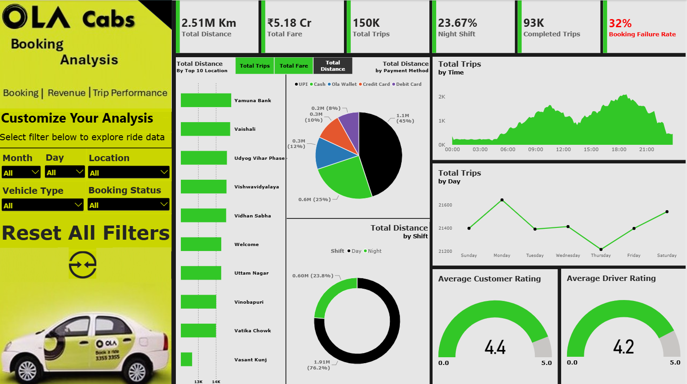

# OLA-cab booking analysis
Interactive Ola Cab Booking Analysis Dashboard built using Power BI. Analyzed 150K+ booking records to uncover insights into ride bookings, revenue, cancellations, customer behavior, driver performance, and booking trends through interactive visualizations and KPIs.

