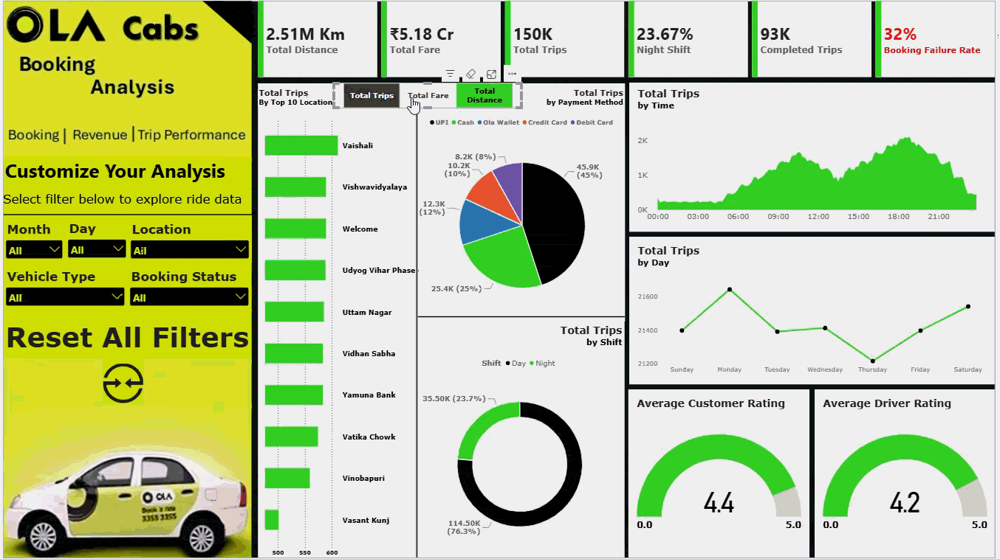

# OLA-cab booking analysis
# 🚖 OLA Cabs Booking Analysis Dashboard

An interactive Power BI dashboard built to analyze 150K+ Ola cab booking records and uncover meaningful business insights through data analytics and visualization.

## 📊 Project Overview

This project focuses on analyzing Ola cab booking data to understand booking performance, revenue trends, customer behavior, ride patterns, and operational efficiency.

The dashboard transforms raw booking data into meaningful insights to support data-driven business decisions.

## 🛠️ Tools & Technologies

- **Power BI** – Interactive dashboard development
- **Power Query** – Data cleaning and transformation
- **DAX** – Measures, KPIs, and calculations
- **Microsoft Excel** – Data handling and preparation

## 📈 Key Performance Indicators

- Total Bookings
- Total Booking Revenue
- Total Distance Travelled
- Customer Ratings
- Driver Ratings
- Booking and Cancellation Analysis

## Key Insights 
- Booking cancellation percentage
- Revenue contribution
- Top-performing locations
- Customer and driver rating insights

## 🔍 Key Analysis Areas

- Overall booking performance
- Revenue and ride analysis
- Booking status and cancellation trends
- Customer and driver ratings
- Location-wise booking analysis
- Interactive KPI and metric comparisons

## 🖥️ Dashboard Preview

## 📂 Project Files

- **Power BI Dashboard (.pbix)** – Interactive dashboard file
- **Dashboard Screenshots (.png)** – Visual representation of the dashboard
- **Dashboard Preview (.gif)** – Dashboard walkthrough

## 🎯 Project Objective

To demonstrate practical data analytics skills by transforming 150K+ booking records into an interactive business intelligence dashboard.

## 👨‍💻 Author

**Prakash Kumar Prajapat**

- GitHub: [PrakashPrajapat01](https://github.com/PrakashPrajapat01)
- LinkedIn: [Connect with me](https://www.linkedin.com/in/hdaprakashkumar)

**Skills:** Power BI | SQL | Excel | Python | Power Query | Data Analytics
